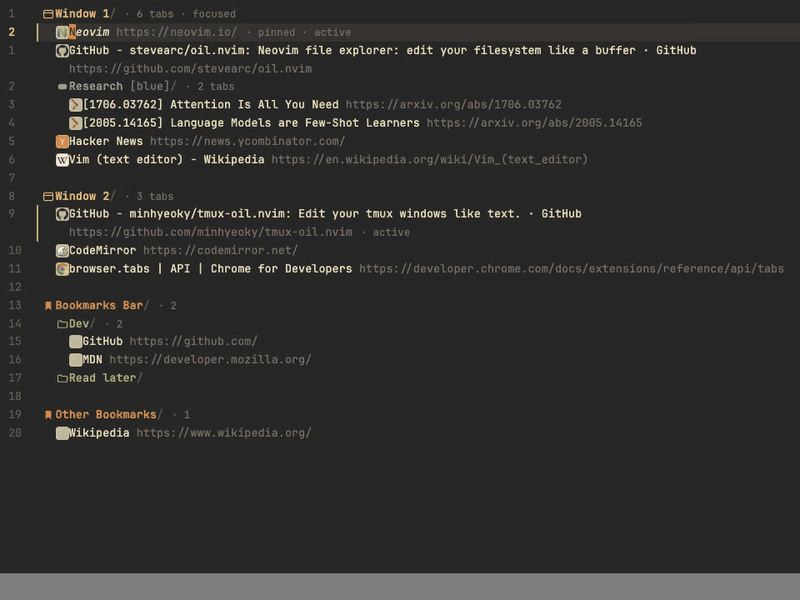

# oil.chrome

Edit Chrome's windows, tab groups, tabs and bookmarks as **one indented outline** in a vim buffer.
Move, copy, rename, regroup and delete with the keys you already know, then `:w` to review and apply.
Same model as [oil.nvim](https://github.com/stevearc/oil.nvim) and [tmux-oil.nvim](https://github.com/minhyeoky/tmux-oil.nvim): the buffer is the desired state,
identity lives in hidden per-line anchors, and there are no heuristics.



> **Bookmark deletions sync to every signed-in device and Chrome has no undo API.**
> `:w` always shows a confirmation first, and every deletion is journaled (the last 20 writes, with the full bookmark
> subtree) in `chrome.storage.local` — there is no restore command yet.

## Install

```sh
npm install
npm run build          # → dist/
```

Chrome → `chrome://extensions` → enable *Developer mode* → *Load unpacked* → pick `dist/`.
Open the editor with **Alt+Shift+O** (rebind at `chrome://extensions/shortcuts`) or the toolbar button.

Branded Chrome ignores `--load-extension`, so the demo and the tests run in Playwright's bundled Chromium; your own
Chrome only gets the extension through the manual steps above.

## What you see

```
/w1 Window 1/                    ← windows (name ignored)
  /t11 Neovim https://neovim.io/
  /g5 Research [blue]/           ← tab group: `title [color]/`
    /t13 Attention https://arxiv.org/abs/1706.03762
  /t15 Hacker News https://news.ycombinator.com/

/b1 Bookmarks bar/               ← bookmark roots, then folders and bookmarks
  /b10 Dev/
    /b11 GitHub https://github.com/
```

The `/t11 ` anchors are hidden behind favicons/glyphs. A line's **position** decides what it is: an entry under a window
is a tab, under a group a tab, under a bookmark folder a bookmark; a line ending in `/` is a window, group or folder
depending on where it sits. A window, group or folder line that keeps its anchor stays one when the `/` is deleted
(unless it ends in a URL), so `cc` followed by a new name renames a group or folder; window names stay ignored.
An anchor whose kind does not match the position creates a new entity of that position (a tab line moved under a
bookmark folder becomes a bookmark and the tab closes; yank it first and the tab stays).

| Grammar | |
|---|---|
| `title url` or just `url` | tab / bookmark (a bare `example.com` also works for a new tab; `localhost:3000` gets `http://`, `example.com:8080` `https://`) |
| `name/` | window, bookmark folder (`foo//` is a folder named `foo/`) |
| `name [blue]/` | tab group; colors: grey blue red yellow green pink purple cyan orange |
| indent | 2 spaces (a tab counts as 2); the parent is the nearest folder line above with a smaller indent |

Preview marks at the end of a line show what `:w` would do: `+ new` `⧉ copy` `→ Window 2` `→ [Research]` `↻ navigate`
`✎ edit` `★ bookmark` `↗ open` `⚠ …` `✗ …`; the status line counts them (`+2 →3 ✎1 ✕4`).

## Keys

| Key | |
|---|---|
| `:w` | review every action in a modal (deletions first, in red) → `y` `Y` `o` `O` `<CR>` apply, `n` `N` `q` `<Esc>` cancel |
| `:wq` `:x` | apply, then close |
| `:q` `q` | close (refused when modified, `:q!` forces) |
| `:e!` `R` | reload from Chrome, discard edits |
| `<CR>` | tab line: switch to it and close the editor · bookmark: open in a new tab · a modified buffer only switches |
| `za` `zc` `zo` `zR` `zM` | folds |
| `g?` | help |
| `Tab` `Shift-Tab` | indent / dedent the line (changes its parent), also in insert mode |
| `dd` `yy` `p` `P` `]p` `>>` `<<` `cc` `cw` `S` `o` … | plain vim; `cc` `S` `C` `D` `x` change the content and keep the identity — only `dd` removes a line |

Chrome changes while the editor is open are followed live as long as the buffer is untouched; otherwise the status line
says `⟳ chrome changed — :e! to reload`.

## How a write is applied

`:w` reads Chrome again and plans against it (content edits compare with what you saw, positions with what is there now),
then runs **create → place → update → delete**:

1. new windows, tabs and bookmarks (a copied or foreign-domain line becomes a new entity);
2. placement is a reconcile loop — move until the layout matches the buffer, then verify — never index arithmetic;
3. navigations, bookmark/group renames and recolors;
4. closes and deletions, skipped as a whole if anything above failed, after journaling what is about to go.

Entities that appeared outside while you were editing are never closed; entities that vanished produce a
`gone — skipped` warning; a line whose parent vanished blocks the write (`:e!`).

## Development

```sh
npm run build     # esbuild → dist/
npm test          # unit tests (node --test): grammar, plan golden cases G1–G28, identity properties, anchors, apply
npm run e2e       # builds, then Playwright Chromium (headless new mode) + the extension; no internet, local pages only
npm run demo      # headed demo with real pages — Playwright Chromium, throwaway profile under .tmp/
npm run record    # headless scripted run → demo/demo.gif, demo/demo.mp4, demo/frames/ (needs ffmpeg)
```

`npm run e2e` also runs two randomised suites: a buffer→Chrome fuzz (`FUZZ_N=250`, replay one with `FUZZ_SEED=<n>`) and a
key fuzz that types random vim operations into the editor and checks that no anchor is damaged
(`ANCHOR_FUZZ_N=3000`, `ANCHOR_FUZZ_SEED=<n>`).

Layout: `src/core/` is the engine (pure: `render`, `parse`, `plan`; chrome-facing: `snapshot`, `apply`),
`src/editor/` the CodeMirror 6 + `@replit/codemirror-vim` frontend, `test/unit/` and `test/e2e/` the tests.
The design notes, including the known defects, are in [`DESIGN.md`](DESIGN.md) (Korean).

## Known limits

Window names, tab titles, mute/pin toggles, the reading list and recently closed tabs are out of scope. Incognito windows
are not listed (extensions are off there by default). Saved tab groups and the account/local bookmark split of recent
Chrome versions are not modelled.

## Related

- [oil.nvim](https://github.com/stevearc/oil.nvim): the file system version of this idea, and the inspiration.
- [tmux-oil.nvim](https://github.com/minhyeoky/tmux-oil.nvim): the same model for tmux sessions and windows.
- [oil.tabs](https://github.com/hamzahshahbazkhan/oil.tabs): the same idea for tabs and windows, also CodeMirror + vim.
- [brotab](https://github.com/balta2ar/brotab): tab control from the command line; `bt move` edits the tab list in `$EDITOR`.
- [TabFS](https://github.com/osnr/TabFS): browser tabs mounted as a filesystem.

## License

[MIT](LICENSE)
